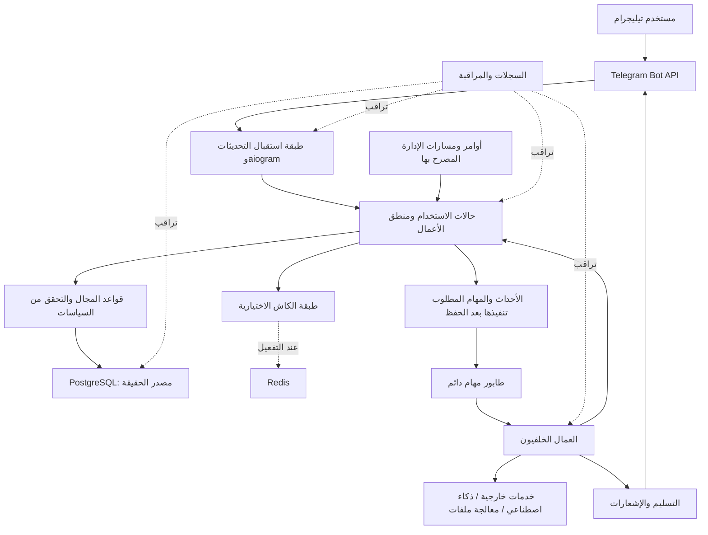

# Architecture.md — المعمارية المرجعية لمنصة الخدمات الدراسية والطلابية عبر بوت تيليجرام

> **حالة الوثيقة:** معمارية مرجعية قابلة للتنفيذ والمراجعة.  
> **المشروع:** بوت تيليجرام لبيع وتقديم الخدمات والمنتجات التعليمية والطلابية.  
> **اللغة الأساسية:** Python 3.11.  
> **إدارة البيئة والاعتماديات:** `uv`.  
> **قاعدة البيانات المستهدفة:** PostgreSQL 18.x.  
> **الإطار الأساسي للبوت:** aiogram 3.x.  
> **مبدأ التصميم الحاكم:** بنية واضحة ومتماسكة، قليلة التعقيد، قابلة للتوسع دون إعادة كتابة النظام، مع سلامة مالية وبيانية عالية.

---

## 1. الغرض من هذه الوثيقة

تحدد هذه الوثيقة المبادئ والحدود والمسؤوليات والقرارات المعمارية التي يجب أن توجّه بناء المشروع وصيانته. وهي مرجع للوكيل المطوّر ولأي مطور لاحق، وليست مجرد وصف عام للتقنيات.

يجب قراءة هذه الوثيقة مع الملفات المرجعية التالية:

- `TODO.md`: قائمة الوظائف والمهام ومعايير قبولها.
- `Project-Jobs.md`: شرح الخدمات والأعمال المطلوبة.
- `database.sql`: التصميم الأولي للمخطط، الذي يجب مراجعته ومزامنته مع التنفيذ.
- `Architecture.md`: هذه الوثيقة، التي تضبط الحدود المعمارية ومبادئ التطوير.

إذا وُجد اختلاف بين الملفات، فلا يجوز تجاهله أو اختيار أحدها بصمت. يجب فهم المتطلب الوظيفي، وتحديد التعارض، ثم توثيق قرار واضح يحافظ على الهدف الأصلي قدر الإمكان. لا تُحذف وظيفة مطلوبة لمجرد تأجيلها عن الإطلاق الأول.

### 1.1 ما يجب أن تحققه المعمارية

1. تقديم تجربة موثوقة عبر بوت تيليجرام بوصفه الواجهة الأساسية للمنتج.
2. دعم الخدمات والمنتجات الـ153 الواردة في ملفات المشروع، مع إمكانية إطلاقها تدريجيًا.
3. حماية دورة الأعمال من بداية الطلب وحتى الدفع والتنفيذ والتسليم والاسترداد.
4. جعل إضافة خدمة أو تعديلها ممكنًا دون تعديل غير ضروري في النظام كله.
5. فصل منطق الأعمال عن واجهة تيليجرام وعن تفاصيل قاعدة البيانات والخدمات الخارجية.
6. تنفيذ المهام الطويلة في الخلفية دون تعليق التفاعل مع المستخدم.
7. جعل Redis اختياريًا للوظائف التي يمكن أن تعمل بدونه، عبر إعداد مركزي واحد.
8. توفير تسجيل أحداث وتشخيص واضح دون تسريب الأسرار أو الإكثار من تسجيل البيانات الشخصية.
9. دعم الاختبار الفعلي، والترحيلات الآمنة، والاستعادة بعد الأعطال.
10. تجنّب التعقيد المبكر والخدمات المنفصلة غير الضرورية.

### 1.2 ما لا تهدف إليه المعمارية

- لا تفرض إنشاء خدمات مصغّرة مستقلة لكل نطاق وظيفي.
- لا تفترض ضرورة إنشاء موقع ويب أو لوحة خارجية في الإصدار الأول.
- لا تجعل Redis مصدر الحقيقة للطلبات أو المدفوعات أو الاستحقاقات.
- لا تجعل جميع الخدمات الـ153 منشورة أو مفعّلة تلقائيًا.
- لا تستخدم التجريدات أو المكتبات لمجرد أنها شائعة أو حديثة.
- لا تعد بأداء غير محدود أو انعدام الأخطاء؛ بل تفرض القياس والاختبار ومعالجة أسباب الفشل.

---

## 2. القرارات المعمارية الأساسية

هذه قرارات افتراضية للمشروع. يمكن تغيير قرار جوهري فقط عند وجود سبب فني أو تشغيلي واضح، وبعد توثيق السبب والبدائل والأثر.

| المجال | القرار المرجعي | السبب والضابط |
|---|---|---|
| أسلوب البناء | **Modular Monolith** منظم إلى نطاقات واضحة | يحافظ على سهولة التطوير والنشر، ويمنع تكلفة الأنظمة الموزعة مبكرًا، مع إبقاء حدود تسمح بالفصل مستقبلًا عند الحاجة. |
| نقطة التفاعل الأساسية | بوت تيليجرام باستخدام aiogram 3.x | يتوافق مباشرة مع طبيعة المنتج ويتيح تنظيم المعالجات ومسارات المحادثة. |
| لغة التشغيل | Python 3.11 | اختيار المستخدم؛ يجب اختبار توافق كل اعتماد قبل تثبيته. |
| إدارة الاعتماديات | uv مع ملف قفل موثوق | يتيح إنشاء بيئة متكررة ومتسقة. |
| مصدر البيانات الدائم | PostgreSQL 18.x | المصدر الموثوق للمستخدمين والطلبات والمدفوعات والاشتراكات وسجلات الأعمال. |
| التعامل مع البيانات | SQLAlchemy 2.x Async ORM | الوصول إلى البيانات عبر طبقة واضحة مع إدارة جلسات ومعاملات سليمة. |
| تغيرات المخطط | Alembic | تاريخ ترحيلات واضح وقابل للمراجعة. |
| التحقق من البيانات والإعدادات | Pydantic وPydantic Settings | توحيد التحقق من المدخلات والإعدادات عند الحدود. |
| Redis | اختياري ومحصور في الوظائف التي يمكنها التراجع إلى بديل آمن | يجب ألا يمنع تعطيله الوظائف التجارية الأساسية. |
| تنفيذ المهام الطويلة | عمال خلفيون وطابور مهام دائم | لا تُنفّذ الأعمال الطويلة داخل معالج تحديث تيليجرام. لا يُشترط أن يعتمد الطابور على Redis. |
| المهام ذات الأثر التجاري | معالجة قابلة للتكرار الآمن، مع سجل دائم | لا تفترض تنفيذ الحدث مرة واحدة فقط. |
| إدارة الخدمات | كتالوج بيانات مع وحدات تنفيذ واضحة | الخدمة الجديدة لا تحتاج إلى إنشاء بنية منفصلة إذا كانت تتبع مسارًا قائمًا. |
| الاختبارات | pytest مع اختبارات وحدات وتكامل ومسارات كاملة | لا يُعتبر وجود الملفات أو الشاشات دليلًا على اكتمال الوظيفة. |
| المراقبة | تسجيل منظم، ومقاييس مفيدة عند الحاجة | يشخّص المشكلات دون إغراق السجلات أو جمع بيانات زائدة. |

### 2.1 قاعدة اختيار الأدوات

لا تُضاف أي مكتبة أو خدمة بنيوية إلا إذا حلّت حاجة حقيقية أفضل من الأدوات الموجودة. يجب مراجعة توافقها مع Python 3.11، ونشاط صيانتها، وتوثيقها، وترخيصها، وسلوكها تحت الفشل، وأثرها في التشغيل والصيانة قبل اعتمادها.

لا تعتمد على نسخة تجريبية أو إصدار غير مستقر في مسار إنتاج حساس دون مبرر وتقييم مخاطر. ثبّت الإصدارات المتوافقة وسجّلها في ملفات المشروع. لا تفترض أن أحدث إصدار من كل مكتبة متوافق مع بقية المنظومة.

---

## 3. الشكل المعماري العام

يُبنى المشروع كقاعدة برمجية واحدة ذات وحدات داخلية مستقلة المسؤوليات، ويمكن تشغيل أجزاء التشغيل منها كعمليات منفصلة عند الحاجة. الانفصال في التشغيل لا يعني نسخ منطق الأعمال أو إنشاء مشاريع منفصلة لكل وظيفة.

### 3.1 المسارات الرئيسية للبيانات



الرسم تصوّر منطقي للمسؤوليات، وليس إلزامًا بإنشاء عملية مستقلة لكل صندوق. في البداية يمكن تشغيل البوت والعامل الخلفي من البيئة نفسها كعمليتين مستقلتين، مع الاعتماد على قاعدة بيانات مشتركة.

### 3.2 مسار التحديث الوارد

1. يستقبل البوت تحديث تيليجرام.
2. تُطبّق ضوابط التحقق الأولية، والتفويض، وتحديد المعدل عند الحاجة.
3. يُحوّل التحديث إلى حالة استخدام واضحة، ولا توضع قواعد العمل التجارية المعقدة داخل معالج الرسالة.
4. تنفّذ حالة الاستخدام التحقق من المدخلات والصلاحيات وقواعد المجال.
5. تُقرأ البيانات وتُعدّل داخل حدود معاملات مناسبة.
6. إذا تطلبت العملية مهمة طويلة أو أثرًا خارجيًا، تُسجّل المهمة أو رسالة الصندوق الصادر بطريقة لا تنفصل عن حفظ التغيير التجاري الضروري.
7. يرسل البوت ردًا مناسبًا بعد معرفة النتيجة الممكن تأكيدها، أو يخبر المستخدم بأن الطلب قيد التنفيذ.
8. يُكمل العامل الخلفي التنفيذ، ويحفظ الحالة، ثم يرسل النتيجة أو الإشعار عبر مسار التسليم.
9. تُسجّل الأحداث التشخيصية المهمة دون تضمين الأسرار أو المحتوى الشخصي غير الضروري.

### 3.3 لا تجعل جميع الأعمال متزامنة مع المستخدم

يجب أن تكون عمليات التصفح، وعرض الخدمات، وتحديث التفضيلات، والعمليات القصيرة سريعة. أما معالجة الملفات الكبيرة، وتوليد المخرجات، والتحليلات، والإشعارات المجدولة، والتنفيذ البشري، وإعادة المحاولات، فيجب أن تُدار كعمليات طويلة أو خلفية عندما تكون طبيعتها تقتضي ذلك.

---

## 4. حدود المسؤوليات واتجاه الاعتماد

### 4.1 الطبقات

#### أ. طبقة واجهة تيليجرام

مسؤوليتها استقبال التحديثات والأوامر والرسائل والأزرار والمدفوعات والملفات، والتحقق من شكل المدخلات عند الحدود، واستدعاء حالات الاستخدام، وعرض رسائل مفهومة.

لا تملك هذه الطبقة مسؤولية تحديد السعر النهائي من تلقاء نفسها، أو منح الاشتراك، أو تقرير صلاحية الاسترداد، أو كتابة استعلامات تجارية مكررة في عدة معالجات.

#### ب. طبقة حالات الاستخدام

تمثل العمليات التي ينفذها النظام، مثل إنشاء طلب، أو قبول طلب معلومات إضافية، أو تسجيل دفعة ناجحة، أو طلب استرداد، أو إنشاء حجز، أو بدء خدمة تعليمية.

تنسّق هذه الطبقة بين المجال والمستودعات والخدمات الخارجية، وتحدد حدود المعاملات وسلوك الفشل، دون ربط قواعد الأعمال بتفاصيل واجهة تيليجرام.

#### ج. طبقة المجال

تضم قواعد العمل والقيود والسلوك الذي يجب أن يبقى صحيحًا مهما كانت نقطة الدخول. أمثلة ذلك: لا يمكن تسليم منتج مدفوع قبل ثبوت الاستحقاق؛ لا يمكن منح الميزة نفسها مرتين بسبب تكرار الحدث؛ لا يمكن تنفيذ حجز متعارض مع حجز مؤكد آخر؛ ولا يجوز نشر خدمة دون بياناتها التجارية المطلوبة.

#### د. طبقة الوصول إلى البيانات

مسؤولة عن استعلامات التخزين وإدارة الجلسات والنماذج والعلاقات. تُستخدم SQLAlchemy وPostgreSQL وفق حدود واضحة. لا ينبغي أن تصبح نماذج التخزين وحدها بديلًا عن قواعد المجال.

#### هـ. طبقة التكاملات

تعزل التفاصيل الخاصة بالأنظمة الخارجية: تيليجرام، ومزودات الذكاء الاصطناعي، والتخزين الخارجي، وأي مزود دفع أو خدمة مؤسسية إضافية. يجب التعامل مع أخطائها ومهلها وحدودها عند هذه الحدود، لا نشر منطق الاتصال الخاص بها داخل جميع وحدات المشروع.

#### و. طبقة العمال والمهام المجدولة

تستقبل مهام التنفيذ من الطابور، وتنفذ الأعمال التي لا يجب أن تبقى داخل مسار استقبال تحديث تيليجرام. يجب أن تستخدم حالات الاستخدام وقواعد المجال نفسها، لا أن تعيد تنفيذ منطق مختلف عنها.

#### ز. طبقة المراقبة والإعدادات

توفر تسجيلًا موحدًا، ومعرّفات تتبع، والتحقق من إعدادات التشغيل، وأدوات فحص الحالة، من دون أن تتحول إلى مصدر لقواعد الأعمال.

### 4.2 اتجاه الاعتماد

- تعتمد واجهة تيليجرام على حالات الاستخدام، ولا تُستخدم كموضع مركزي لقواعد المجال.
- تعتمد حالات الاستخدام على عقود المجال والخدمات المطلوبة، ولا ترتبط بتفاصيل رسائل Telegram.
- لا يعتمد المجال على aiogram أو Redis أو واجهات خارجية مباشرة.
- الوصول إلى البيانات والتكاملات أدوات تنفيذية خلف حدود واضحة.
- يستخدم العامل الخلفي حالات الاستخدام والمجال نفسيهما.
- لا يجوز أن يتسبب إدخال كاش أو تغييره في اختلاف قواعد العمل أو مصدر الحقيقة.

### 4.3 ممنوعات معمارية

- معالجات تيليجرام التي تنفذ كل العمل مباشرة في دالة ضخمة.
- نسخ قواعد التسعير أو الصلاحيات أو منح الاستحقاقات في أكثر من مكان.
- وصول عشوائي إلى قاعدة البيانات من جميع أجزاء النظام دون حدود واضحة.
- إنشاء اتصال أو جلسة قاعدة بيانات جديدة لكل استعلام دون إدارة تجميع الاتصالات.
- مشاركة جلسة SQLAlchemy واحدة بين مهام متزامنة متعددة.
- استدعاء خدمة خارجية بانتظار طويل داخل معاملة قاعدة بيانات.
- الاعتماد على الكاش لحسم عمليات مالية أو صلاحيات حساسة.
- استيراد متبادل دائري بين نطاقات المجال.
- إنشاء وحدات مستقلة لكل خدمة من الخدمات الـ153 إذا كانت تشترك في التدفق نفسه.
- حفظ أسرار أو بيانات دفع حساسة أو كلمات مرور في المستودع أو السجلات.

---

## 5. تنظيم المستودع والمجلدات

البنية التالية تنظيم مرجعي مقترح، وليست مبررًا لنقل كل ملف موجود دون مراجعة. إذا كانت بنية المشروع الحالية تحقق المبادئ نفسها، فحافظ عليها ما لم يكن التغيير مفيدًا فعلًا.

```text
project-root/
├── src/
│   └── app/
│       ├── bootstrap/             # إنشاء المكونات وبدء التشغيل والإغلاق
│       ├── config/                # الإعدادات والتحقق منها
│       ├── bot/                   # routers, handlers, keyboards, filters, middleware
│       ├── modules/               # نطاقات المجال وحالات الاستخدام
│       │   ├── accounts/
│       │   ├── access_control/
│       │   ├── catalog/
│       │   ├── orders/
│       │   ├── payments/
│       │   ├── subscriptions/
│       │   ├── entitlements/
│       │   ├── service_requests/
│       │   ├── delivery/
│       │   ├── education/
│       │   ├── providers/
│       │   ├── bookings/
│       │   ├── opportunities/
│       │   ├── institutions/
│       │   ├── notifications/
│       │   ├── support/
│       │   ├── reviews/
│       │   ├── files/
│       │   └── audit/
│       ├── infrastructure/        # DB, cache, queue, external service adapters
│       ├── workers/                # تسجيل المهام وعمال التنفيذ
│       ├── observability/          # logging, correlation, metrics, health
│       └── shared/                 # أدوات صغيرة مشتركة لا تخص مجالًا بعينه
├── migrations/                    # سجل ترحيلات قاعدة البيانات
├── tests/
│   ├── unit/
│   ├── integration/
│   ├── flows/
│   ├── security/
│   └── performance/
├── scripts/                       # مهام تشغيل ومراجعة آمنة
├── docs/                          # وثائق داعمة إذا احتاج المشروع ذلك
├── logs/                          # سجلات محلية دوّارة، مستبعدة من التحكم بالمصدر
├── database.sql                   # نسخة تهيئة مرجعية إذا كانت مطلوبة للتسليم
├── TODO.md
├── Project-Jobs.md
├── Architecture.md
├── pyproject.toml
├── uv.lock
├── .env.example
├── .gitignore
└── README.md
```

### 5.1 ضوابط هيكل المجلدات

- لا تنشئ مجلدًا أو ملفًا لمجرد أن المثال يحتوي عليه؛ أنشئه حين توجد مسؤولية حقيقية.
- تجنّب مجلدًا عامًا ضخمًا باسم `utils` يتحول إلى مكان عشوائي لكل شيء.
- لا تضع قواعد المجال في `shared` لمجرد أنها تُستخدم من أكثر من موضع؛ يجب أن تظل مملوكة للنطاق الصحيح.
- أبقِ معالجات تيليجرام رقيقة قدر الإمكان.
- افصل الاختبارات وفق الغرض، ولا تخلط الاختبارات ذات الآثار الخارجية باختبارات الوحدات السريعة.
- لا تحفظ السجلات المحلية أو الملفات الحساسة أو بيانات البيئة الحقيقية داخل التحكم بالمصدر.
- لا تكرر مجلدات أو طبقات موجودة بالفعل إذا كان تنظيم المشروع يحقق الحدود المطلوبة.

---

## 6. نطاقات المجال ومسؤولياتها

ينبغي تنظيم وظائف المشروع حول مجالات الأعمال، وليس حول قائمة من 153 اسم خدمة منفصلًا. الخدمات عناصر كتالوج؛ أما المجالات التالية فهي مسؤوليات دائمة في النظام.

### 6.1 الحسابات والملفات الشخصية — Accounts

مسؤول عن هوية المستخدم الداخلية، وربطها بهوية تيليجرام، وحالة الحساب، والملف التعليمي الاختياري، وتفضيلات اللغة والمنطقة الزمنية والإشعارات، وسجل الموافقات اللازمة.

الضوابط:

- هوية تيليجرام تُربط بمعرّف المنصة الثابت، لا بالاسم الظاهر وحده.
- فصل هوية المستخدم عن ملفه التعليمي وتفضيلاته متى ساعد ذلك على الوضوح وتقليل البيانات.
- لا تُجمع معلومات لا تلزم لتقديم الخدمة.
- تُراجع طلبات الحذف والتصدير وفق سياسة الاحتفاظ والسجلات التي يجب بقاؤها.
- لا تُخزن كلمات مرور الجامعة أو رموزها أو بيانات اعتماد المستخدم.

### 6.2 الوصول والصلاحيات — Access Control

مسؤول عن الأدوار والصلاحيات، وتفويض الأفعال الحساسة، وحسابات المسؤولين والمشرفين ومقدمي الخدمات وأعضاء المؤسسات.

الضوابط:

- التحقق من الصلاحية داخل حالة الاستخدام أو حد المجال، لا بمجرد إخفاء زر.
- توثيق الأفعال الإدارية الحساسة في سجل التدقيق.
- لا تمنح الامتيازات بناءً على اسم مستخدم قابل للتغيير إذا كان هناك معرّف داخلي موثوق.
- تطبيق أقل صلاحية لازمة على كل عملية.

### 6.3 الكتالوج والعروض — Catalog

مسؤول عن تصنيفات الخدمات، وتعريفات الخدمات، والعروض القابلة للبيع، ووصف الخدمة وحدودها ومدخلاتها ومخرجاتها وحالتها، وإصدارات العروض عند الحاجة.

الضوابط:

- يمكن تمثيل الخدمات الـ153 من خلال أنواع وعروض وبيانات تعريفية؛ لا يُنشأ جدول مستقل لكل خدمة دون حاجة دامغة.
- الخدمة الجديدة تبدأ غير منشورة، ولا تُعرض للبيع قبل استكمال وصفها وسعرها وشروطها وحدودها ومعلومات التسليم المطلوبة.
- تُفصل بيانات الكتالوج الحالي عن لقطة الشراء التاريخية.
- لا تُخزن العلاقات الأساسية داخل حقل JSON عام.
- يجوز استخدام بيانات مرنة لخصائص اختيارية متغيرة إذا بقيت العلاقات والحقول ذات الأهمية التجارية علائقية وواضحة.

### 6.4 الطلبات — Orders

مسؤول عن طلب المستخدم، وعناصر الطلب، ولقطة العرض والسعر وقت الشراء، وحالة الطلب وتاريخ تغيرها، والإلغاء وما يرتبط به من أسباب.

الضوابط:

- حالات الطلب لا تختزل حالة الدفع أو التنفيذ أو التسليم.
- لا يُعدّل السعر التاريخي بسبب تغيير سعر الكتالوج.
- الطلبات المكررة الناتجة عن إعادة المحاولة لا تنشئ آثارًا تجارية إضافية.
- الحذف لا يمحو تاريخًا ماليًا أو تشغيليًا مطلوبًا للاحتفاظ.

### 6.5 المدفوعات والاستردادات — Payments

مسؤول عن الفواتير والمراجع الخارجية وعمليات الدفع والاستردادات وسجلات أحداث الدفع والتحقق من المبلغ والعملة والطلب.

الضوابط:

- بيع الخدمات والمنتجات الرقمية داخل تيليجرام يجب أن يلتزم بآلية Telegram Stars وقواعدها الحالية.
- يجب الرد على استعلام ما قبل الدفع ضمن المهلة التي تتطلبها المنصة، باستعلام قصير لا يتضمن معالجة طويلة.
- لا يُسجّل الدفع الناجح بناءً على رسالة المستخدم أو لقطة شاشة.
- تُحفظ معرّفات المعاملات الخارجية اللازمة للتتبع ومنع التكرار والاسترداد.
- تضمن القيود والمعاملات عدم إنشاء العملية أو تطبيق آثارها أكثر من مرة.
- تُستخدم أعداد صحيحة بوحدات العملة الصغرى حيث يكون ذلك هو التمثيل المناسب، وتُمنع الأنواع العشرية العائمة للأموال.
- لا يُعتبر تحديث حالة الطلب وحده سجلًا ماليًا كافيًا.

### 6.6 الاشتراكات والاستحقاقات — Subscriptions & Entitlements

مسؤول عن خطط الاشتراك ومدته وحالته والتجديد والإلغاء والانتهاء وحدود الاستخدام والحقوق التي تمنحها الخطة للمستخدم.

الضوابط:

- فصل الاشتراك التجاري عن الاستحقاقات الناتجة عنه.
- تاريخ واضح لبداية الاستحقاق وانتهائه ومصدر منحه.
- منع منح الاستحقاق نفسه مرتين بسبب تكرار حدث الدفع أو إعادة المحاولة.
- فحص الاستحقاقات الحساسة من المصدر الموثوق، وعدم الاعتماد على كاش قديم وحده.
- انتهاء الاشتراك لا يحذف السجل المالي أو التاريخي.

### 6.7 طلبات الخدمات والتنفيذ — Service Requests & Execution

مسؤول عن الطلبات التي تحتاج إلى مدخلات مخصصة أو معالجة آلية أو تدخل بشري، وعن المرفقات والمخرجات ومحاولات التنفيذ والمراجعات والحالات.

الضوابط:

- فصل تعريف الخدمة عن الطلب المخصص وعن محاولات تنفيذه وعن مخرجاته.
- حفظ مرجع المهمة ومعلومات حالتها، لا وضع كل التفاصيل في حقل واحد غير منظم.
- يجب أن تكون إعادة التنفيذ آمنة أو محكومة بمعرّف منع التكرار.
- يسجل ما يلزم لفهم فشل التنفيذ دون الاحتفاظ غير الضروري بمحتوى خاص.
- لا يُعلن إكمال الطلب قبل وجود نتيجة قابلة للتحقق.

### 6.8 التسليم والملفات — Delivery & Files

مسؤول عن ملفات المنتجات ومرفقات المستخدمين والمخرجات الرقمية ومراجع التخزين وحالات الإرسال والوصول وإعادة التسليم وسياسات الاحتفاظ.

الضوابط:

- تخزين الملفات الكبيرة في تخزين ملفات مناسب، لا في أعمدة قاعدة البيانات دون مبرر قوي.
- الاحتفاظ بالبيانات الوصفية والمرجع ومعلومات الوصول اللازمة فقط.
- تطبيق حدود الحجم والنوع وحقوق الوصول.
- منع استخدام مسارات الملفات أو أسماء الملفات للوصول إلى موارد خارج النطاق المسموح.
- عدم إرسال الملف إلى مستخدم قبل التحقق من ملكيته أو استحقاقه.
- إخضاع الملفات للسياسة المناسبة عند انتهاء المدة أو طلب الحذف.

### 6.9 المحتوى والتعلم — Education

مسؤول عن المواد والموضوعات والاختبارات التدريبية والأسئلة والمحاولات والإجابات والبطاقات التعليمية والخطط الدراسية والتقدم والتذكيرات التعليمية.

الضوابط:

- فصل تعريف السؤال عن نسخة الإجابة ضمن محاولة محددة.
- تغيّر محتوى السؤال لا يغيّر نتائج تاريخية دون قصد.
- تُراعى حقوق المحتوى والمواد المرخصة.
- تُعد المخرجات التعليمية داعمة للتعلم؛ لا يجوز تقديم حلول اختبارات جارية أو كتابة أعمال أكاديمية كاملة نيابة عن الطالب.
- تُعرض تنبيهات مناسبة عندما يمكن أن تخطئ المخرجات الآلية.

### 6.10 مقدمو الخدمات والحجوزات — Providers & Bookings

مسؤول عن ملفات المدرسين أو الخبراء، وتخصصاتهم، وتوافرهم، والحجوزات والجلسات وإعادة الجدولة والإلغاء والحضور والتقييم والعمولات عندما يكون نموذج النشاط يتطلبها.

الضوابط:

- لا يجوز تأكيد حجز متعارض مع حجز آخر غير مسموح بتداخله.
- منع التعارض يجب أن يعمل تحت التزامن، لا عبر فحص توافر ثم إدراج غير محمي.
- تُحفظ أوقات المواعيد بلحظات زمنية واضحة، ويُعرض الوقت حسب المنطقة الزمنية المناسبة.
- لا تُعرض بيانات الطالب أو المدرس لجهة غير مخولة.

### 6.11 المنح والوظائف والفرص — Opportunities

مسؤول عن الفرص ومصادرها ومواعيدها وشروطها وتاريخ التحقق منها، وحفظ الفرص للمستخدم وتتبع طلبات التقديم والتذكيرات المرتبطة بها.

الضوابط:

- يجب تمييز المصدر وتاريخ آخر تحقق من المعلومات.
- لا يُقدم وعد بالقبول أو التوظيف.
- تُفصل بيانات الفرصة العامة عن سجل متابعة المستخدم الخاص.
- لا تُخترع بيانات أو مواعيد أو روابط غير متحقق منها.

### 6.12 المؤسسات — Institutions

مسؤول عن المدارس والجامعات ومراكز التدريب والعضوية والأدوار المؤسسية والتراخيص وحدود الاستخدام والحجوزات والتذاكر والتقارير المجمعة عند الحاجة.

الضوابط:

- أي بيانات مؤسسية خاصة يجب أن تكون مرتبطة بحدود وصول صريحة.
- لا تعتمد على معرف المؤسسة المرسل من المستخدم دون التحقق من عضويته.
- إذا فُعّل عزل بيانات المؤسسات على مستوى قاعدة البيانات، فيجب أن تكون السياسات مكتملة واختبارية، لا شكلية.
- لا يلزم تعقيد الإطلاق الفردي بمزايا مؤسسية غير مفعلة، لكن لا ينبغي أن يمنع التصميم إضافتها لاحقًا.

### 6.13 الإشعارات — Notifications

مسؤول عن التذكيرات والتنبيهات التشغيلية والتسويقية المسموح بها، وقنوات الإرسال والحالة والمحاولات وتفضيلات المستخدم.

الضوابط:

- فشل الإشعار لا يلغي الطلب أو الدفع الذي سبقه.
- منع إرسال الرسالة نفسها بصورة متكررة عند إعادة المحاولة، حيث يكون ذلك ممكنًا.
- فصل الإشعارات الضرورية للطلب عن التنبيهات التسويقية.
- مراعاة التوقيت والمنطقة الزمنية وتفضيلات المستخدم.

### 6.14 الدعم والتقييمات والنزاعات — Support & Reviews

مسؤول عن التذاكر والردود والشكاوى والتقييمات والنزاعات ومراجعة قرارات الدعم.

الضوابط:

- ربط الشكوى بالطلب أو الدفع أو الخدمة عندما يكون لذلك صلة.
- حفظ الحالة والمسؤول والقرار والتوقيت عند الحاجة.
- لا تُعرض تقييمات غير حقيقية أو غير مستوفية للشروط بوصفها تقييمات موثوقة.
- تقليل ظهور المحتوى الشخصي أثناء مراجعة الشكاوى.

### 6.15 التدقيق — Audit

مسؤول عن تسجيل العمليات الإدارية والمالية والأمنية الحساسة، وطلبات حذف البيانات، وتغييرات الصلاحيات والسياسات المهمة.

الضوابط:

- سجل التدقيق لا يحتوي أسرارًا أو كلمات مرور أو رموز وصول.
- لا يُعتبر ملف سجلات محلي وحده سجلًا دائمًا موثوقًا للأحداث المالية.
- يجب تحديد من يستطيع الاطلاع على سجلات التدقيق ومدة الاحتفاظ بها.
- لا تُدّعَ عدم قابلية السجل للتلاعب إلا إذا وُجدت ضوابط فعلية تدعم ذلك.

---

## 7. تصميم الخدمات الـ153 وقابلية الإضافة

الخدمات الـ153 تمثل إمكانات تجارية وتعليمية، وليست 153 تطبيقًا مستقلًا. يجب أن تستوعبها البنية من خلال كتالوج مرن، وأنماط تنفيذ مشتركة، ووحدات مجال متخصصة عند الحاجة.

### 7.1 فصل ثلاثة مفاهيم

1. **تعريف الخدمة:** ما الخدمة، ولمن تناسب، وما مدخلاتها ومخرجاتها وحدودها وسياساتها.
2. **العرض التجاري:** كيف تُباع الخدمة، وما السعر والوحدة والمدة والحدود والباقات المتاحة لها.
3. **طلب تنفيذ الخدمة:** ما الذي طلبه هذا المستخدم تحديدًا، وما مدخلاته وحالته وتنفيذه ومخرجاته.

لا تدمج المفاهيم الثلاثة في سجل واحد يجعل تغيير السعر يؤثر في الطلبات السابقة أو تعديل وصف خدمة يغيّر حقيقة ما اشتراه المستخدم.

### 7.2 أنماط التنفيذ

ينبغي أن يدعم النظام، حسب الحاجة، أنماطًا مثل:

- نتيجة فورية قصيرة.
- مهمة آلية طويلة.
- مهمة معالجة ملف.
- مهمة مراجعة بشرية.
- حجز موعد أو جلسة.
- محتوى رقمي جاهز.
- اشتراك يمنح استحقاقات متجددة.
- متابعة فرصة أو تذكير مجدول.
- خدمة مؤسسية مرتبطة بجهة وعضوية.

تُربط كل خدمة بنمط تنفيذ واضح ومعلن. لا يُنشأ محرك عام بالغ التعقيد من البداية؛ تُضاف الأنماط التي تبررها وظائف `TODO.md` و`Project-Jobs.md`.

### 7.3 إضافة خدمة جديدة

يجب أن تتم إضافة خدمة شبيهة بالخدمات الحالية غالبًا عبر:

1. تعريف بياناتها وتصنيفها.
2. تحديد المدخلات والمخرجات والقيود التجارية.
3. اختيار نمط التنفيذ الموجود المناسب.
4. ربطها بمكوّن التنفيذ المطلوب إن كانت تحتاج سلوكًا جديدًا.
5. تحديد سياسة السعر والتسليم والمراجعات والخصوصية.
6. إضافة اختبارات قبولها.
7. مراجعتها ثم تفعيلها من الإدارة.

لا تسمح لبيانات الكتالوج بتنفيذ شيفرات اعتباطية أو استعلامات أو أوامر. البيانات تصف الخدمة؛ التنفيذ الفعلي يظل داخل مكونات معروفة ومراجعة.

### 7.4 الإطلاق التدريجي

تُحفظ الخدمات الـ153 ضمن النطاق الكامل للمشروع، لكن تبدأ الخدمات الجديدة في حالة مسودة أو غير منشورة. لا تنشر خدمة للبيع قبل استكمال السعر والوصف والنطاق والمدخلات والمخرجات ومدة التسليم والشروط وسياسة التعديل والإلغاء والاسترداد، بحسب ما ينطبق عليها.

---

## 8. قاعدة البيانات ونموذج البيانات

PostgreSQL هو مصدر الحقيقة الدائم. كل تغيير تجاري مهم يجب أن يُحفظ فيه بصورة تسمح بالرجوع إلى حالته وفهم أثره.

### 8.1 القواعد العامة

- استخدم مفاتيح أساسية ثابتة، وميّزها عن معرّفات تيليجرام أو المعرّفات الخارجية.
- استخدم أنواع بيانات مناسبة؛ لا تستخدم النص لكل شيء أو أعدادًا عائمة لتخزين المال.
- استخدم `TIMESTAMPTZ` للأحداث التي تمثل لحظة زمنية، وخزّن الزمن بصورة موحدة ثم اعرضه حسب المنطقة الزمنية.
- استخدم `FOREIGN KEY` و`UNIQUE` و`NOT NULL` و`CHECK` حيث تحمي حقيقة تجارية واضحة.
- اختر سياسات الحذف بعناية، ولا تستخدم `CASCADE` على نطاق واسع دون تحليل أثره.
- لا تضع قوائم علاقات في نص مفصول بفواصل.
- لا تستخدم حقل JSONB بدل الجداول العلائقية للحقول التي تحتاج علاقات أو فهارس أو قيودًا أساسية.
- استخدم JSONB لخصائص مرنة مبررة، مع شكل معروف ومُتحقق منه وإصدار عند الحاجة.
- افصل السجلات المالية والتاريخية عن محتوى المستخدم الذي قد يلزم حذفه.
- لا تضف تقسيم الجداول أو فهارس واسعة أو تجميع بيانات مسبقًا قبل وجود حاجة مدروسة.

### 8.2 السعر والمال

- يجب أن يحتوي كل مبلغ على قيمة واضحة وعملة معروفة.
- في Telegram Stars، استخدم وحدة العملة الصحيحة التي تفرضها المنصة، ولا تُجرِ تحويلات أو حسابات عشرية غير لازمة.
- لا تستخدم `float` أو `REAL` للقيم المالية.
- احفظ لقطة السعر والكمية والخصم والعرض الذي وافق عليه العميل وقت الشراء عند انطباقها.
- لا تغيّر طلبًا تاريخيًا عند تحديث سعر الكتالوج.
- سجّل الاسترداد كعملية مرتبطة بالعملية الأصلية، لا بوصفه تعديلًا صامتًا لمبلغ الدفع.

### 8.3 المعاملات والتزامن

يجب تحديد حدود المعاملات بوضوح. يُفضّل أن تكون المعاملة قصيرة، وألا تتضمن انتظارًا لشبكة خارجية أو معالجة ملفات طويلة.

استخدم القيود الفريدة والأقفال والمعاملات المناسبة حيث يلزم، خصوصًا في:

- إنشاء طلب أو دفع.
- تسجيل حدث دفع خارجي.
- منح استحقاق.
- استهلاك حد استخدام.
- تجديد أو إلغاء اشتراك.
- حجز فترة زمنية.
- تسليم منتج مدفوع.
- جدولة مهمة مرتبطة بتغيير محفوظ.

لا تفترض أن فحص الحالة ثم تحديثها آمن تحت التزامن دون قيد أو قفل أو شرط تحديث مناسب. يجب اختبار العمليات المتزامنة ذات الأثر المالي أو التجاري.

### 8.4 إدارة SQLAlchemy

- تُنشأ جلسة مستقلة ضمن نطاق العملية أو المهمة، ولا تتم مشاركتها بين مهام متزامنة.
- تُغلق الجلسة والاتصالات بطريقة منظمة.
- تُحدّد حدود المعاملة في حالات الاستخدام، لا بصورة عشوائية داخل كل استعلام.
- تُراجع استعلامات العلاقات لتجنب التحميل الزائد والاستعلامات المتكررة.
- لا تُخفى أخطاء المعاملات ولا يستمر التنفيذ بعد فشل يجعل الحالة غير آمنة.

### 8.5 Alembic و`database.sql`

- تُعد ترحيلات Alembic سجل تطور المخطط المعتمد.
- يجب مراجعة الترحيـلات المولدة قبل تطبيقها، خصوصًا عند إعادة تسمية أو حذف أو تغيير نوع بيانات.
- يجب أن يكون `database.sql` متوافقًا مع المخطط الفعلي إذا كان ملف تهيئة أو تسليم مطلوبًا.
- لا تدار تغييرات المخطط بصورة مستقلة ومتعارضة في SQL وORM والترحيلات.
- لا تحتوي ملفات التهيئة على بيانات اعتماد أو بيانات مستخدمين حقيقية.
- لا تُستخدم أوامر مدمرة على قاعدة قائمة دون فحص النسخ الاحتياطية وخطة الترحيل وأثرها.

### 8.6 الفهارس

تُنشأ الفهارس بناءً على الاستعلامات المتوقعة والمقاسة، وليس على كل عمود بشكل تلقائي. راجع الاستعلامات الأكثر استخدامًا، والفلاتر المركبة، والفرز، والقيود الفريدة، ومفاتيح العلاقات. قِس أثر أي تحسين مهم على القراءة والكتابة وحجم البيانات.

### 8.7 سياسات الاحتفاظ والحذف

يجب تصنيف البيانات إلى بيانات حساب ومحتوى مرفوع وسجلات أعمال وسجلات مالية وسجلات أمنية. لا تطبق سياسة واحدة على الجميع.

- احذف أو أخفِ هوية المحتوى الشخصي عندما تسمح السياسة والمتطلبات بذلك.
- احتفظ بالسجل المالي الضروري وفق سياسة معلنة ومتطلبات التشغيل المنطبقة.
- لا تستخدم الحذف المنطقي في كل جدول تلقائيًا.
- يجب أن تكون عملية حذف بيانات المستخدم قابلة للتتبع دون نسخ المحتوى الخاص إلى سجلات التدقيق.

---

## 9. الأحداث، منع التكرار، والصندوق الصادر

لا يمكن ضمان أن كل تحديث أو إشعار خارجي سيصل مرة واحدة فقط أو بالترتيب المتوقع. لذلك يجب تصميم المسارات الحساسة لتتحمل التكرار والفشل الجزئي.

### 9.1 مفاتيح منع التكرار

استخدم مرجعًا فريدًا مناسبًا لكل عملية قابلة للتكرار، بحسب مصدرها ونطاقها، مثل معرّف تحديث تيليجرام أو معرّف معاملة الدفع أو مفتاح عملية داخلية. يجب تطبيق القيد على مستوى التخزين عندما يكون ذلك ممكنًا، لا الاكتفاء بفحص في الذاكرة.

مبدأ أساسي: يمكن أن تُستدعى العملية أكثر من مرة، لكن لا يجب أن ينتج عن ذلك تكرار غير مشروع للآثار التجارية.

### 9.2 نمط الصندوق الصادر (Outbox)

عندما يتطلب تغيير دائم إرسال إشعار أو تشغيل مهمة خلفية، يجب تجنب وضع حفظ التغيير وإرسال الرسالة الخارجية في تسلسل يؤدي إلى ضياع أحدهما عند فشل الآخر.

استخدم نمط صندوق صادر دائم أو آلية مكافئة موثوقة عند الحاجة:

1. حفظ التغيير التجاري وتسجيل الأثر الذي يجب تنفيذه ضمن المعاملة المناسبة.
2. يقرأ معالج مستقل الأثر غير المكتمل.
3. ينفذ الإرسال أو المهمة.
4. يسجل النتيجة والمحاولات.
5. يعيد المحاولة وفق سياسة واضحة عند الخطأ المؤقت.
6. يحوّل الحالات المستنفدة إلى حالة قابلة للمراجعة بدل إعادة المحاولة بلا نهاية.

لا يُشترط استخدام الصندوق الصادر لكل رسالة بسيطة غير حرجة، لكنه مهم في مسارات الدفع والاستحقاق والتسليم والإشعارات التي يسبب فقدانها تضاربًا تجاريًا.

### 9.3 لا تعد بمعالجة Exactly-Once من الشبكة

قد يعاد تنفيذ المهمة بعد توقف عامل في منتصف العمل. المطلوب هو تصميم أثر آمن عند التكرار عبر قيود وفحوص وعمليات قابلة للتكرار بأمان، لا افتراض أن النقل أو الطابور سيضمن تنفيذًا وحيدًا في جميع الحالات.

---

## 10. الطوابير والمهام الخلفية والتوازي

### 10.1 ما الذي يُنفذ في الخلفية؟

على الأقل، قيّم استخدام المهام الخلفية للعمليات الآتية عندما تطول أو تتطلب إعادة محاولة أو جدولة:

- معالجة ملفات PDF والصور والتسجيلات.
- توليد التلخيصات والاختبارات والمخرجات التعليمية.
- المعالجة المعتمدة على مزود ذكاء اصطناعي.
- التسليم وإعادة التسليم.
- الإشعارات والتذكيرات المجدولة.
- تنفيذ الطلبات التي تحتاج إلى خبير بشري أو متابعة.
- مهام الصيانة والتنظيف والاحتفاظ بالبيانات.
- التقارير غير الفورية والتحليلات.

### 10.2 اختيار نظام الطابور

يجب أن يكون الطابور دائمًا وقابلًا للتعافي، ولا يُشترط أن يعتمد على Redis. قبل اختيار مكتبة بعينها، تحقّق من توافقها مع Python 3.11، ودعمها للعمليات غير المتزامنة عند الحاجة، وحالة صيانتها، وخصائص إعادة المحاولة والجدولة والتحكم بالتزامن ومراقبة الوظائف.

**التوجه الافتراضي:** فضّل طابور مهام مدعومًا بـ PostgreSQL عندما يحقق متطلبات المشروع بصورة موثوقة؛ فهذا يتيح أن يظل تنفيذ المهام متاحًا عند تعطيل Redis، ويدعم حفظ مهمة مرتبطة بتغيير بيانات ضمن مسار معاملاتي متماسك. لا تعتمد على مكتبة حديثة أو غير كافية الصيانة قبل التحقق منها. إذا لم توجد حزمة مناسبة، فاعتمد آلية محدودة ودقيقة قائمة على PostgreSQL بعد تقييم جدوى ذلك، أو اختر وسيطًا مستقلاً موثقًا لا يرتبط بمفتاح Redis الخاص بالكاش.

لا تنفّذ نظام طوابير عامًّا ومعقدًا من الصفر إذا كانت مكتبة مستقرة تلبّي الحاجة. وإذا بُنيت آلية محدودة داخل المشروع، فيجب أن تتضمن على الأقل حالة المهمة، ووقت الإتاحة، وعدد المحاولات، وموعد إعادة المحاولة، ووقت بدء التنفيذ، وقفل أو مهلة حيازة، ومعالجة المهام المتروكة، وحدود التوازي، وسجل فشل نهائي، واختبارات للتزامن وإعادة التشغيل.

### 10.3 عقد المهمة

كل مهمة ينبغي أن تكون:

- محددة الاسم والغرض.
- مرتبطة بمعرّف مرجعي لا بمحتوى كبير منقول داخل الرسالة.
- قابلة للتتبع عبر معرّف مهمة ومرجع الأعمال.
- محددة المهلة وحدود الموارد قدر الإمكان.
- قابلة لإعادة المحاولة إذا كان ذلك آمنًا.
- محمية من تكرار الأثر التجاري.
- واضحة في قواعد النجاح والفشل والإلغاء.
- غير معتمدة على ذاكرة عملية البوت لبقاء بياناتها.

### 10.4 سياسة إعادة المحاولة

- أعد المحاولة للأخطاء المؤقتة فقط.
- استخدم تأخيرًا تدريجيًا وحدًا أعلى معروفًا.
- لا تُعد المحاولة بلا نهاية.
- لا تكرر عملية دفع أو تسليم خارجي دون معرفة ما إذا كانت العملية السابقة قد نجحت.
- افصل بين الخطأ الذي يستوجب إعادة المحاولة والخطأ الذي يتطلب تدخلًا بشريًا أو بيانات مصححة.
- احتفظ بمعلومات كافية لتشخيص المهمة الفاشلة دون تسجيل محتوى خاص غير ضروري.

### 10.5 حدود التوازي

يجب تحديد عدد المهام المتزامنة بناءً على سعة قاعدة البيانات، وحدود مزود الذكاء الاصطناعي، وحدود Telegram، والذاكرة والمعالج. لا تنشئ مهامًا غير محدودة. استخدم حدودًا منفصلة عند الحاجة للأعمال التي تستهلك موارد مختلفة، مع السماح بزيادة عدد العمال تدريجيًا.

---

## 11. Redis والتخزين المؤقت الاختياري

يجب أن يكون تفعيل Redis مركزيًا بواسطة مفتاح بيئة واحد:

`REDIS_ENABLED`

القيم المسموحة والسلوك عند القيمة غير الصالحة يجب أن يكونا واضحين في الإعدادات. يُفضّل رفض إعداد غير مفهوم بدل تفسيره بطرق مختلفة في أجزاء النظام.

### 11.1 عندما يكون Redis مفعّلًا

يمكن استخدامه للوظائف التي تستفيد من الوصول السريع أو الحالة المؤقتة، مثل:

- كاش بيانات الكتالوج العامة.
- بعض نتائج البحث أو بيانات العرض غير الحساسة.
- حالات محادثة مؤقتة غير حرجة إذا كان ذلك مناسبًا.
- تنسيق حدود المعدل إذا كانت آلية موزعة مطلوبة.
- وسائل تنسيق مؤقتة لا تُعد مصدرًا نهائيًا للبيانات.

### 11.2 عندما يكون Redis معطّلًا

- يجب ألا يحاول النظام فتح اتصال به.
- يجب ألا يتطلب بدء تشغيل البوت وجود Redis للوظائف الأساسية.
- تُقرأ البيانات القابلة للكاش من PostgreSQL أو من المصدر الموثوق مباشرة.
- يجب أن تبقى الطلبات والمدفوعات والاشتراكات والحقوق وحالات التنفيذ محفوظة بصورة دائمة.
- تُحفظ حالة سير العمل المهم في PostgreSQL، لا في ذاكرة FSM فقط.
- يمكن أن تضيع حالة واجهة مؤقتة غير حرجة عند إعادة التشغيل إذا لم يوجد مخزن دائم، لكن يجب ألا يضيع طلب تجاري أو يُفسد.
- لا يجوز أن يؤدي تعطل Redis إلى إعلان نجاح خاطئ أو منح استحقاق مكرر.

### 11.3 حدود مهمة

مفتاح `REDIS_ENABLED` يتحكم في التكامل الاختياري مع Redis، لكنه لا يخفي اعتمادًا آخر. إذا كان الطابور أو أي مكوّن أساسي يعتمد على وسيط مستقل، فيجب ضبط ذلك وتوثيقه منفصلًا. لا تربط الطابور الدائم بالكاش ثم تدّعي أن جميع المهام تعمل مع Redis معطّل.

### 11.4 سياسة الكاش

استخدم نمطًا واضحًا مثل القراءة من الكاش ثم المصدر الأساسي عند الغياب، مع مدة صلاحية معقولة وإبطال عند تغير المصدر. لا تخزّن بيانات مالية أو قرارات وصول حساسة في الكاش بوصفها مرجعًا نهائيًا. لا تستخدم الكاش لتجاوز فحص صلاحية عملية الدفع أو الاستحقاق.

---

## 12. إدارة الحالة والمحادثات في تيليجرام

تحتاج بعض الخدمات إلى مسارات متعددة الخطوات، مثل اختيار الخدمة ثم توفير التفاصيل ثم رفع ملف ثم مراجعة الطلب.

### المبادئ

- تُستخدم حالة المحادثة لتوجيه تجربة المستخدم، لا لتخزين الحقيقة التجارية الوحيدة.
- يجب حفظ الطلبات والمسودات والمدخلات التجارية المهمة في التخزين الدائم متى كان فقدانها سيضر المستخدم.
- يجب أن يستطيع المستخدم العودة أو الإلغاء أو استكمال العملية أو معرفة حالتها.
- يجب أن تنتهي الحالات المؤقتة وتُرفض الأزرار القديمة أو الطلبات المنتهية بطريقة مفهومة.
- لا تفترض أن كل تحديث سيصل بالترتيب الذي تتوقعه.
- عند استخدام تخزين حالة مؤقت، لا تجعل تعطيل Redis سببًا لفقدان طلب مدفوع أو معلومات ضرورية للتنفيذ.
- لا تجعل ذاكرة عملية واحدة شرطًا لنجاح سير العمل إذا كان من الممكن تشغيل أكثر من نسخة من البوت.

### أزرار وعمليات حساسة

لا تثق بمحتوى زر أو callback لمجرد أن البوت أنشأه سابقًا. أعد التحقق من المستخدم والطلب والحالة والصلاحيات قبل تنفيذ أي إجراء حساس. يجب أن تكون العمليات المنتهية أو المستهلكة سابقًا غير قابلة لإعادة التطبيق بصورة خاطئة.

---

## 13. التكامل مع Telegram Payments وTelegram API

تيليجرام هو حد خارجي؛ يمكن أن تتأخر التحديثات أو تتكرر، وقد تفشل عمليات الإرسال بسبب المعدلات أو الشبكة أو تغيّر حالة المحادثة.

### 13.1 مدفوعات المنتجات الرقمية

- التزم بمتطلبات Telegram Stars الحالية عند بيع خدمات أو منتجات رقمية داخل البوت.
- تحقّق من الطلب والمبلغ والعملة قبل قبول استعلام ما قبل الدفع.
- أجب عن استعلام ما قبل الدفع بسرعة ضمن المهلة المعلنة من تيليجرام.
- لا تنفذ أعمالًا ثقيلة أو انتظار شبكة غير ضروري في مسار ما قبل الدفع.
- سجّل نجاح الدفع الفعلي باستخدام المعرّفات التي توفرها المنصة.
- طبّق قيودًا فريدة ومعالجة آمنة للتحديثات المتكررة.
- لا تمنح الاستحقاق إلا بعد التحقق من عملية الدفع وربطها بالطلب الصحيح.
- سجّل آثار الدفع والاستحقاق والتسليم على نحو يمكن مراجعته.
- احتفظ بمرجع المعاملة المطلوب لخدمة العملاء والاسترداد.

### 13.2 الرسائل والإرسال

- طبّق حدود معدل الإرسال بحسب قواعد تيليجرام.
- استخدم طابورًا أو جدولة للرسائل الكبيرة أو المتعددة.
- تعامل مع المستخدم الذي حظر البوت أو لم تعد محادثته متاحة دون إسقاط الطلب الأصلي.
- افصل فشل الإرسال عن نجاح العملية التجارية السابقة.
- قلّل تكرار الرسائل عند إعادة المحاولة باستخدام مفاتيح مناسبة للأحداث التي ينبغي إرسالها مرة واحدة منطقيًا.

### 13.3 Polling وWebhook

اختر طريقة تشغيل واحدة في كل بيئة عبر إعداد واضح، ولا تشغّل Polling وWebhook على التوكن نفسه بطريقة تتعارض.

- Polling مناسب للتطوير والبدايات عندما تتوافق بيئة الاستضافة مع ذلك.
- Webhook مناسب عندما تتوفر نقطة HTTPS عامة موثوقة وإعداد تشغيل مناسب.
- عند التوسع، راعِ تفرد مستهلك التحديثات أو إدارة التكرار، وخصوصًا للتحديثات ذات الآثار التجارية.
- يجب أن يتعامل بدء التشغيل والإيقاف والفشل مع تنظيف الموارد وإعادة الاتصال بطريقة صحيحة.
- لا تُسجّل التوكن ضمن أخطاء الاتصال أو إعدادات التشغيل.

---

## 14. الملفات والمحتوى الذي يرفعه المستخدم

### 14.1 مسار الملف

1. التحقق من صلاحية المستخدم وسياق الطلب.
2. التحقق من حجم الملف ونوعه وحدود الخدمة.
3. قبول الملف ضمن تدفق رفع واضح.
4. حفظه في تخزين مناسب، وحفظ بياناته المرجعية في قاعدة البيانات.
5. إجراء فحوص الأمان والمعالجة الضرورية حسب نوع الملف.
6. تمرير مرجع الملف إلى المهمة الخلفية بدل تمرير محتواه الكبير بين المكونات.
7. حفظ النتيجة وربطها بالطلب.
8. تسليم المخرج وفق الاستحقاق والسياسة.
9. حذف أو إخفاء الملفات عند انتهاء مدة الاحتفاظ أو استيفاء طلب حذف صحيح.

### 14.2 حدود الأمان والخصوصية

- لا تثق بالامتداد وحده لتحديد نوع الملف.
- لا تسمح بأسماء الملفات أو المراجع بالوصول خارج منطقة التخزين المسموحة.
- لا تفتح أو تنفّذ ملفات المستخدم بوصفها شيفرات.
- تجنّب تحميل روابط خارجية عشوائية دون ضوابط إذا أضيفت وظيفة جلب محتوى عبر رابط.
- لا تعرض الملف أو رابط التخزين لمستخدم غير مخول.
- لا تستخدم محتوى المستخدم لتحسين النماذج أو تدريبها أو مشاركته مع جهة أخرى دون موافقة مناسبة.
- سجّل المرجع والحالة والبيانات التشغيلية الضرورية دون نسخ المحتوى الخاص كاملًا في السجلات.

### 14.3 المخرجات

يجب أن تكون المخرجات مرتبطة بالطلب والإصدار أو المحاولة التي أنتجتها حيث يلزم، مع حالة واضحة وصلاحية وصول معروفة. لا تستبدل المخرج التاريخي بصمت إذا كانت هناك حاجة إلى حفظ ما تسلمه المستخدم فعلًا.

---

## 15. الذكاء الاصطناعي والخدمات الخارجية

يجب أن تكون خدمات الذكاء الاصطناعي خلف واجهة تكامل واضحة، بحيث لا ترتبط وحدات الطلبات والمدفوعات بمزود واحد أو نموذج واحد.

### 15.1 المسؤوليات

- تحديد نوع العملية المطلوبة.
- التحقق من مدخلاتها وحدود الملف والحجم والمدة.
- اختيار الخدمة أو النموذج المعتمد وفق إعدادات معلومة.
- تطبيق مهلات وحدود للتزامن والتكلفة عند توفر بيانات التكلفة.
- التعامل مع انتهاء المهلة والأخطاء المؤقتة وأخطاء المحتوى.
- حفظ مرجع المهمة ومعلومات التشغيل الضرورية.
- ربط المخرج بالطلب ومراجعته قبل التسليم عند الحاجة.
- احترام موافقة المستخدم وسياسات الاحتفاظ بالمحتوى.

### 15.2 قابلية تبديل المزود

يجب ألا تنتشر أسماء مزودات الذكاء الاصطناعي أو صيغ طلباتها في جميع نطاقات المجال. تكون تفاصيل المزود داخل محول تكامل خاص به، بينما تتعامل حالة الاستخدام مع مفهوم وظيفي واضح مثل التلخيص أو توليد اختبار أو تحليل كود.

### 15.3 الجودة والأمان

- المخرجات الآلية قد تخطئ؛ لا تقدّمها باعتبارها حقيقة مؤكدة بلا مراجعة عند الحاجة.
- لا تستخدم مخرجات نموذج بوصفها صلاحية دفع أو قرارًا أمنيًا.
- لا تُدخل بيانات المستخدم في سجلات أو خدمات خارجية دون حاجة وضوابط مناسبة.
- لا تضمن نتائج دراسية أو توظيفية.
- لا تقدم حلًا لاختبار جارٍ أو تنشئ عملًا أكاديميًا كاملًا لانتحال الطالب.
- لا تختلق مراجع أو بيانات أو نتائج تجارب.
- ينبغي إتاحة مراجعة بشرية للخدمات التي يتطلب مستوى جودتها ذلك.

### 15.4 التكلفة وحدود الاستهلاك

إذا كانت هناك خدمات مدفوعة أو محدودة الاستخدام، سجّل القياسات اللازمة لحساب الاستهلاك بصورة مناسبة، وطبّق حدًا واضحًا على مستوى المستخدم أو الخطة عندما يكون ذلك جزءًا من العرض. لا تسمح بإعادة المحاولة غير المحدودة أن تنشئ استهلاكًا خارجيًا متكررًا دون تتبع.

---

## 16. تسجيل الأحداث والمراقبة

يجب أن يكون تسجيل الأحداث شاملاً للأحداث المهمة، منظمًا، قابلًا للبحث والتدوير، ومناسبًا لتشخيص الأعطال دون إغراق السجلات.

### 16.1 متطلبات التسجيل

سجّل بحسب الحاجة:

- بدء التشغيل والإيقاف ونتائج التهيئة.
- عمليات الطلب والدفع والاستحقاق والتسليم ذات الصلة.
- بدء المهام الخلفية وانتهائها ومدة التنفيذ.
- فشل الاتصالات الخارجية والمهل وإعادة المحاولة.
- أخطاء قاعدة البيانات والمعاملات التي فشلت.
- تغييرات الصلاحيات والإجراءات الإدارية الحساسة.
- نتائج التحقق التي تفيد في التشخيص دون كشف بيانات حساسة.
- حالة الاتصال بالمكونات الأساسية والمكونات الاختيارية.
- معرفات التتبع والطلب والمهمة عندما تكون متاحة ومناسبة.

### 16.2 المستويات والملفات

استخدم مستويات واضحة للأحداث: `DEBUG` و`INFO` و`WARNING` و`ERROR` و`CRITICAL` وفق معناها الصحيح.

يمكن إنشاء ملفات منفصلة للسجلات العامة والتحذيرات والأخطاء والتدقيق عند الحاجة التشغيلية، مع تدوير تلقائي وحدود للحجم ومدة الاحتفاظ. في بيئات الحاويات أو الاستضافات التي تتولى جمع السجلات، فضّل توجيه السجلات إلى المخرجات القياسية بحيث تتولى بيئة التشغيل إدارتها. يبقى مجلد `logs/` مناسبًا للسجلات المحلية عند الحاجة، ويجب استبعاده من التحكم بالمصدر.

### 16.3 السياق والتتبع

عندما تكون مفيدة، أرفق معرف تتبع للعملية ومعرف الطلب ومعرف المهمة ومعرف المستخدم الداخلي، دون تضمين معرّفات حساسة غير لازمة. يجب أن يمكن ربط استقبال الطلب بتنفيذه وتسليمه ضمن سلسلة أحداث قابلة للفهم.

### 16.4 حماية السجلات

لا تسجّل:

- رمز بوت تيليجرام أو مفاتيح API أو كلمات المرور.
- عناوين اتصال تحتوي على أسرار.
- بيانات مالية أو شخصية كاملة لا تلزم للتشخيص.
- محتوى ملفات المستخدم أو محادثاته بالكامل لمجرد وجودها.
- رموز التحقق أو الرموز المميزة أو بيانات اعتماد خارجية.

عند تسجيل استثناء، اجعل الأثر الاستدعائي متاحًا لمستوى التشخيص المناسب، لكن لا تُرسل تفاصيله الداخلية للمستخدم. لا تكرر تسجيل الخطأ نفسه في كل طبقة دون إضافة سياق مفيد.

### 16.5 سجل التدقيق ليس سجل التطبيق

ملفات التطبيق للتشخيص التشغيلي. أما الأحداث المالية والإدارية التي تتطلب الاحتفاظ والمراجعة، فيجب أن يكون لها سجل دائم محمي في قاعدة البيانات أو آلية معتمدة تناسب الغرض. لا تعتمد على ملف محلي قد يُفقد وحده لإثبات تاريخ الدفع.

---

## 17. الأمان والخصوصية

### 17.1 إدارة الأسرار

- تُحمّل الأسرار من متغيرات البيئة أو آلية أسرار آمنة مناسبة لبيئة النشر.
- يُحفظ `.env.example` بأسماء المتغيرات وقيم غير سرية فقط.
- يُستبعد `.env` والسجلات المحلية والملفات الخاصة من التحكم بالمصدر.
- لا تُطبع الإعدادات كاملة عند بدء التشغيل.
- تُمنع الأسرار من الظهور في الاستثناءات والسجلات والتقارير.

### 17.2 المصادقة والتفويض

- تُحدد هوية المستخدم من تحديث موثوق من تيليجرام ويُربط بمعرّف داخلي.
- تُفحص الصلاحيات عند كل إجراء حساس.
- تُحمى أوامر الإدارة والعمليات المالية والحجوزات وتغيير الإعدادات.
- لا تكون معرفة اسم أمر أو callback كافية لتنفيذ عملية.
- تُراجع صلاحية مالك الطلب أو الاشتراك أو الملف قبل الاطلاع أو التعديل.

### 17.3 التحقق من المدخلات

- التحقق من جميع المدخلات عند الحدود.
- تحديد أطوال النصوص وأحجام الملفات وأنواعها وفق الحاجة.
- استخدام استعلامات آمنة ومعاملات مربوطة بدل تركيب استعلامات من مدخلات المستخدم.
- التحقق من الروابط والملفات والمراجع الخارجية إذا كانت الوظيفة تتعامل معها.
- منع تنفيذ محتوى المستخدم بوصفه تعليمات تشغيلية أو شيفرات.

### 17.4 تحديد المعدل ومقاومة الإساءة

ضع حدودًا مناسبة حسب العملية والمستخدم، خاصة عند إرسال الرسائل ورفع الملفات وتشغيل خدمات مكلفة أو تنفيذ محاولات تسجيل دخول إدارية. يجب أن يكون سلوك تجاوز الحدود واضحًا للمستخدم، وألا يؤدي إلى حظر غير مبرر للوظائف الأساسية.

إذا كان Redis معطّلًا، فلا تعتمد سياسة الحماية بالكامل على ذاكرة مؤقتة تختفي؛ استخدم بديلًا مناسبًا أو وثّق نطاق الحماية المتاح في ذلك الوضع.

### 17.5 الخصوصية

- اجمع الحد الأدنى من البيانات اللازمة.
- عرّف غرض الاستخدام ومدة الاحتفاظ.
- افصل الموافقة على تقديم الخدمة عن الموافقة على استخدام المحتوى لأغراض أخرى.
- امنع الوصول بين المستخدمين إلى ملفات أو طلبات بعضهم.
- طبّق سياسات خاصة عند التعامل مع القاصرين وفق السوق المقصود.
- لا تعِد استخدام محتوى المستخدم لأغراض غير معلنة.
- وفّر مسارًا لحذف البيانات أو إخفاء هويتها وفق سياسة الاحتفاظ.

### 17.6 النزاهة الأكاديمية وحقوق المحتوى

يجب أن تساند الخدمات التعلم والفهم والمراجعة، لا الغش أو الانتحال. ينبغي أن تمنع سياسات الخدمة تقديم إجابات جاهزة لاختبار جارٍ، أو كتابة بحث أو تقرير أو مشروع كامل باسم الطالب، أو اختلاق مراجع أو نتائج، أو بيع مواد مسربة أو محمية دون ترخيص. ينبغي أن تتيح الشرح والتلميحات ومراجعة محاولة الطالب وإنشاء تدريبات أصلية ومراجعة اللغة مع الحفاظ على أفكاره.

---

## 18. الإعدادات والتشغيل

يجب تجميع الإعدادات في مكان واحد والتحقق منها عند بدء التشغيل. لا تُبعثر قراءة متغيرات البيئة في وحدات الأعمال.

### 18.1 مجموعات الإعدادات

تُدار الإعدادات حسب مجموعات مفهومة، بحسب ما يحتاجه المشروع فعليًا:

- إعدادات التطبيق والبيئة.
- اتصال PostgreSQL ومجمّع الاتصالات.
- تهيئة تيليجرام وطريقة استقبال التحديثات.
- إعدادات Redis الاختيارية.
- إعدادات الطابور والعمال الخلفيين.
- إعدادات التخزين الخارجي للملفات.
- إعدادات مزودي الذكاء الاصطناعي عند استخدامها.
- سياسات المهلة وإعادة المحاولة والتوازي.
- إعدادات السجلات والاحتفاظ بها.
- حدود رفع الملفات والاستهلاك.

لا يلزم توفير متغير لكل تفصيل داخلي؛ الإعدادات تكون قابلة للضبط عندما تختلف فعليًا بين البيئات أو تتطلب تشغيلًا مرنًا.

### 18.2 `REDIS_ENABLED`

يجب تفسير المفتاح مركزيًا مرة واحدة. عند تعطيله، لا تنشأ اتصالات Redis ولا تُستدعى وظائفه الاختيارية. لا تجعل الوحدات تفسر القيمة بطرق مختلفة.

### 18.3 الإعدادات الإلزامية والاختيارية

- إذا كان غياب إعداد يمنع وظيفة أساسية، أوقف تهيئة تلك الوظيفة برسالة واضحة بدل الاستمرار بحالة غير صحيحة.
- إذا كان مكوّن اختياري معطلًا، يجب أن يبقى التطبيق قادرًا على تشغيل الوظائف التي لا تعتمد عليه.
- لا تُدرج قيمًا سرية في وثائق التشغيل.
- افحص القيم وحدودها، مثل حجم المجمّع والمهل وعدد المحاولات، عند بدء التشغيل.

### 18.4 أوضاع التشغيل

يجب أن يكون تشغيل البوت والعامل الخلفي والاختبارات واضحًا وقابلًا لإعادة الإنتاج. لا تشغّل عمليتين تتنافسان على استقبال تحديثات تيليجرام بطريقة غير مقصودة. يجب أن تكون أوامر بدء التشغيل والإيقاف نظيفة ومحدثة في `README.md`.

---

## 19. الأداء واستخدام الموارد

### 19.1 مبدأ الأداء

لا يُحكم على النظام بأنه سريع لمجرد استخدام `async` أو Redis. يجب قياس زمن الاستجابة والأخطاء وزمن المهام واستهلاك الموارد على المسارات المهمة.

### 19.2 قواعد أساسية

- لا تنفّذ أعمالًا حاجبة أو حسابات ثقيلة في حلقة الأحداث.
- استخدم جلسة قاعدة بيانات ضمن نطاق واضح، ولا تشارك الجلسة بين المهام المتزامنة.
- اضبط حد الاتصالات ومقدار التوازي.
- اجعل المعاملات قصيرة وتجنب اتصالًا خارجيًا داخل معاملة مفتوحة.
- لا تجلب كل السجلات أو كل مخرجات الملفات إذا كان المطلوب جزءًا صغيرًا منها.
- راجع أنماط الاستعلامات والفهارس وفق القياس.
- استخدم الكاش للبيانات المناسبة فقط مع سياسة صلاحية وإبطال واضحة.
- مرّر مراجع الملفات بين المكونات بدل نسخ المحتوى الكبير حيث يمكن ذلك.
- اضبط حدود رفع الملفات والاستهلاك والتوازي بما يناسب سعة بيئة التشغيل.
- استخدم إرسالًا مجدولًا أو محدود المعدل عند إرسال إشعارات كثيرة.

### 19.3 مؤشرات يجب مراقبتها

عند توافر أدوات القياس، راقب على الأقل:

- زمن استجابة التحديثات التفاعلية.
- عدد الأخطاء ونسبتها حسب الفئة.
- زمن تنفيذ المهام الخلفية.
- عدد المهام المنتظرة وعمر أقدم مهمة.
- عدد المحاولات وإخفاقات التنفيذ النهائية.
- مدة استعلامات قاعدة البيانات الأكثر استخدامًا.
- حجم مجمّع الاتصالات وانتظار الاتصال.
- نجاح وفشل إرسال الرسائل.
- معدل فشل التسليم.
- نسبة الطلبات التي تحتاج تدخلًا يدويًا.
- استهلاك الخدمات الخارجية عندما تتاح بياناته.

لا تُحدد أهداف أداء غير واقعية مسبقًا. قِس خط أساس واقعيًا ثم ضع أهدافًا قابلة للتحقق، وأعد القياس بعد التحسين.

---

## 20. الاختبارات وضمان الجودة

لا يُعد أي بند مكتملًا بمجرد كتابة واجهته أو ملفاته. يجب أن يكون سلوكه قابلًا للتحقق.

### 20.1 اختبارات الوحدات

اختبر قواعد المجال والحسابات والانتقالات بين الحالات وتحديد الاستحقاقات والتحقق من الأهلية والحدود، دون الاعتماد على خدمة خارجية حقيقية ما لم تكن هذه هي الغاية من الاختبار.

### 20.2 اختبارات التكامل

اختبر تفاعل وحدات المشروع مع PostgreSQL، والترحيلات، والطابور، والكاش عند تفعيله، والتكاملات الخارجية في بيئة مناسبة.

### 20.3 اختبارات المسارات الكاملة

اختبر رحلات المستخدم الرئيسية، مثل:

1. بدء الاستخدام وإنشاء الملف الأساسي.
2. تصفح خدمة منشورة وقراءة تفاصيلها.
3. إنشاء طلب وحفظ السعر والشروط وقت الشراء.
4. التحقق من الدفع وتسجيله.
5. منح استحقاق واحد فقط.
6. تنفيذ المهمة وتسليم النتيجة.
7. إعادة إرسال حدث الدفع نفسه دون تكرار الآثار.
8. فشل التسليم ثم استعادته دون خصم أو تسليم مزدوج.
9. انتهاء الاشتراك وإيقاف الحقوق المناسبة.
10. إلغاء حجز أو إعادة جدولته بطريقة صحيحة.
11. تشغيل الوظائف الأساسية وRedis معطل.
12. التعامل مع خدمة خارجية غير متاحة.
13. التحقق من عدم وصول مستخدم إلى طلب مستخدم آخر.
14. حذف أو إخفاء بيانات شخصية دون مسح السجلات الضرورية.

### 20.4 اختبارات التزامن

اختبر السيناريوهات التي يمكن أن تتنافس فيها عمليتان على مورد واحد، خصوصًا الحجز، وخصم حدود الاستخدام، ومنح الاستحقاقات، وتسجيل المدفوعات أو الاستردادات. لا تعتمد على اختبار تسلسلي لإثبات سلامة سلوك متزامن.

### 20.5 اختبارات الترحيلات

اختبر إنشاء مخطط جديد، وتطبيق الترحيلات على مخطط موجود وفق المسار المدعوم، والتحقق من القيود والفهارس والبيانات بعد الترحيل. لا تجرب التغييرات المدمرة على قاعدة إنتاجية.

### 20.6 اختبارات الأمان

اختبر صلاحيات الإدارة والوصول إلى الملفات والطلبات، وتحقق المدفوعات، والمدخلات غير الصحيحة، وحدود المعدل، وتسريب الأسرار في السجلات.

### 20.7 تعريف اكتمال المهمة

لا تُعلّم المهمة مكتملة إلا بعد:

- تنفيذ السلوك المطلوب.
- معالجة الحالات الاستثنائية المهمة.
- إضافة أو تحديث الاختبارات المناسبة.
- تشغيل الاختبارات ذات الصلة والتحقق من نتائجها.
- مراجعة الصلاحيات والخصوصية عند انطباقها.
- تحديث الوثائق عند تغير السلوك أو التشغيل.
- إزالة نقاط التنفيذ الوهمية أو TODO التي تمنع اكتمال الوظيفة.

إذا تعذر تنفيذ اختبار بسبب غياب خدمة خارجية أو اعتماد سري، فيجب بيان ذلك بدقة، دون ادعاء أن التكامل اختُبر فعليًا.

---

## 21. دورة التطوير والتغيير

### 21.1 قبل التعديل

1. اقرأ المهمة والملفات المرتبطة بها.
2. حدّد نطاق التأثير والوظائف التي تعتمد على الجزء المراد تغييره.
3. افحص التنفيذ الحالي والاختبارات قبل التعديل.
4. حدد ما إذا كان التغيير يتطلب ترحيل بيانات أو تعديل إعداد أو وثيقة.

### 21.2 أثناء التعديل

- قدّم تغييرات صغيرة متماسكة قدر الإمكان.
- لا تمزج إعادة تنظيم واسعة مع تغيير سلوك حساس دون ضرورة.
- حافظ على أسماء ومفاهيم موحدة.
- لا تكرر قواعد الأعمال.
- أضف الاختبارات بجانب الوظيفة بدل تأجيلها إلى النهاية.
- لا تستخدم إخفاء الأخطاء أو تعطيل الاختبارات لتجاوز فشل التنفيذ.

### 21.3 بعد التعديل

- شغّل الاختبارات والفحوص ذات الصلة.
- راجع التغييرات بحثًا عن الأسرار أو الملفات غير المقصودة.
- حدّث `TODO.md` بناءً على التحقق.
- حدّث وثائق التشغيل أو المعمارية عند الحاجة.
- وثّق أي قرار يغير حدود المكونات أو طريقة التشغيل أو مصدر الحقيقة.

### 21.4 قرارات المعمارية

عند اتخاذ قرار مؤثر لا يُستنتج بسهولة من الوثيقة، سجّله كقرار معماري مختصر يتضمن: السياق، القرار، البدائل المهمة، أسباب الاختيار، والمخاطر أو النتائج. لا حاجة إلى توثيق كل اختيار صغير.

---

## 22. النشر والتشغيل والاستعادة

### 22.1 المكونات التشغيلية

الحد الأدنى المعتاد للتشغيل:

- عملية البوت لاستقبال تحديثات تيليجرام وخدمة المستخدم.
- PostgreSQL بوصفه مصدر البيانات الدائم.
- عملية عامل خلفي لتنفيذ المهام الطويلة.
- Redis فقط عند تفعيله للوظائف الاختيارية المعتمدة عليه.
- تخزين ملفات مناسب عند تفعيل رفع الملفات والمخرجات الكبيرة.

يمكن تشغيل العامل والجدولة بعملية واحدة في البداية إذا كان ذلك آمنًا وواضحًا، ثم فصلهما عند الحاجة التشغيلية. لا يُفرض توزيع الخدمات قبل الحاجة.

### 22.2 بدء التشغيل

- تحقق من الإعدادات الأساسية.
- افتح موارد الاتصال حسب الحاجة.
- افحص اتصال قاعدة البيانات واعتماديات الوظائف الأساسية.
- لا تحاول الاتصال بـ Redis عند تعطيله.
- تحقق من إعداد طريقة استقبال تحديثات تيليجرام.
- ابدأ العامل الخلفي بصورة مستقلة عن استقبال التحديثات متى تطلب التشغيل ذلك.
- سجّل نتيجة التهيئة دون طباعة أسرار.

### 22.3 الإغلاق

- أوقف استقبال عمل جديد بطريقة منظمة.
- اسمح للمهام القائمة بإنهاء آمن ضمن مهلة محددة حيث أمكن.
- أغلق جلسات واتصالات الموارد.
- لا تحذف أو تسقط المهام غير المنجزة عند الإيقاف.
- سجّل الإغلاق والأعمال التي بقيت معلقة إن أمكن.

### 22.4 النسخ الاحتياطي والاستعادة

يجب أن تُحدد بيئة النشر سياسة نسخ احتياطي لقاعدة البيانات وتخزين الملفات، وأن تختبر الاستعادة دوريًا. وجود نسخة احتياطية لم تُجرّب استعادتها لا يكفي وحده لإثبات القدرة على التعافي.

تُحدد مدة الاحتفاظ بالنسخ حسب متطلبات العمل والخصوصية والموارد. لا تُحفظ الأسرار داخل النسخة الاحتياطية غير المحمية، وتُقيد صلاحية الوصول إليها.

### 22.5 الترحيلات في النشر

- تُراجع الترحيلات قبل النشر.
- تُشغّل الترحيلات بطريقة تمنع تشغيل نسخ متزامنة منها عن غير قصد.
- يُؤخذ أثرها في زمن الإيقاف وحجم البيانات بعين الاعتبار.
- تغييرات البيانات الحساسة تتطلب خطة تراجع أو معالجة تعويضية مناسبة.
- لا تبدأ نسخة التطبيق الجديدة على افتراض أن مخطط القاعدة تغيّر بنجاح دون تحقق.

---

## 23. استراتيجية التوسع

### المرحلة الأولى: منتج متماسك

- بوت واحد منظّم إلى نطاقات واضحة.
- قاعدة PostgreSQL واحدة.
- عامل خلفي واحد أو عدد محدود من العمال.
- كاش اختياري.
- تفعيل مجموعة مختارة من الخدمات.
- اختبارات للمسارات المالية والحساسة.
- تسجيل وتشغيل موثوقان.

### المرحلة الثانية: زيادة الحمل

عندما تُظهر القياسات الحاجة:

- زيادة عدد العمال وفق حدود آمنة.
- فصل أنواع المهام كثيفة الموارد عن المهام السريعة.
- ضبط مجمع اتصالات قاعدة البيانات ومعدلات تيليجرام.
- تحسين الاستعلامات والفهارس التي ثبت أنها مكلفة.
- تحسين التخزين المؤقت وإبطال الكاش.
- نقل الملفات إلى تخزين خارجي ملائم إذا زاد الحجم.

### المرحلة الثالثة: توسع بنيوي عند الحاجة

لا تُفصل وحدة إلى خدمة مستقلة إلا عندما يوجد سبب واضح، مثل احتياج موارد مختلف، أو دورة نشر مستقلة، أو فريق مستقل، أو حدود أمان مختلفة، أو حمل لا يناسب بقية النظام.

قبل فصل أي وحدة، يجب أن تكون حدودها واضحة وعقودها مستقرة، وأن تُعرف كيفية التعامل مع فشل الاتصال والاتساق والرسائل المكررة. لا تُستخدم الخدمات المصغرة كهدف بحد ذاته.

### 23.1 ما يجب عدم فعله مبكرًا

- نشر عشرات الخدمات المستقلة.
- إدخال منصة تنسيق حاويات معقدة دون احتياج.
- تقسيم قاعدة البيانات قبل وجود سبب تشغيلي.
- تخزين كل أنواع البيانات في مخازن متعددة دون فائدة.
- إنشاء نظام كاش لكل جدول.
- بناء محرك إضافات عام لتشغيل شيفرات ديناميكية من قاعدة البيانات.

---

## 24. إدارة قائمة المهام ومراحل الإطلاق

`TODO.md` هو سجل التنفيذ الوظيفي. يجب أن تظل جميع الوظائف المطلوبة موجودة فيه حتى عند تأجيلها.

### 24.1 ترتيب العمل

رتّب التنفيذ حسب الاعتماديات والمخاطر، لا حسب سهولة وضع علامة الإنجاز. الأولوية عادةً تكون:

1. أساس تشغيل المشروع والإعدادات والتحقق من بيئة التطوير.
2. قاعدة البيانات والترحيلات والاتصالات وتسجيل الأحداث.
3. الحسابات والصلاحيات والكتالوج.
4. الطلبات وتثبيت تفاصيل الشراء.
5. المدفوعات والاستحقاقات ومنع التكرار.
6. تنفيذ المهام الخلفية والتسليم والاستعادة من الفشل.
7. لوحة/أوامر الإدارة الأساسية والتذاكر والمراقبة.
8. أنماط الخدمات التعليمية الأكثر أولوية.
9. الاشتراكات والحجوزات والفرص والمزايا المؤسسية بحسب خطة الإطلاق.
10. توسيع بقية الخدمات واختبارها تدريجيًا.

هذا ترتيب توجيهي؛ يجب تعديله إذا أظهرت ملفات المتطلبات اعتماديات مختلفة. لا يعني تأجيل فئة حذفها من النطاق.

### 24.2 حالات المهام

استخدم حالات صريحة، مثل: لم تبدأ، قيد التنفيذ، مكتملة بعد التحقق، متوقفة بعائق، مؤجلة لمرحلة لاحقة. لا تُعتبر المهمة مكتملة إذا كان جزءها الأساسي مقلدًا أو وهميًا أو غير مختبر عند الحاجة.

### 24.3 إطلاق الخدمات

قبل نشر أي خدمة، تأكد من:

- وصف واضح وفائدة محددة.
- مدخلات ومخرجات وحدود معلومة.
- سعر وشروط معتمدة.
- سياسة تنفيذ وتسليم.
- ضوابط خصوصية وحقوق محتوى.
- اختبارات للمسار الأساسي وحالات الفشل.
- طريقة الدعم والإلغاء والاسترداد حيث ينطبق.
- قدرة المسؤول على إيقاف الخدمة دون إفساد الطلبات القديمة.

---

## 25. مصفوفة المخاطر والضوابط

| الخطر | الأثر المحتمل | الضابط المعماري |
|---|---|---|
| تكرار تحديث دفع | منح منتج أو اشتراك عدة مرات | معرّف فريد، قيود تخزين، معاملة، ومعالجة متكررة آمنة |
| نجاح الدفع وفشل رسالة التأكيد | التباس المستخدم أو إعادة الدفع | سجل دفع دائم، حالة قابلة للاستعلام، وصندوق صادر عند الحاجة |
| فشل التسليم بعد الدفع | عدم حصول العميل على ما اشتراه | مهمة تسليم دائمة، إعادة محاولة آمنة، ومراقبة للحالات المتعثرة |
| انقطاع Redis | توقف غير مبرر للخدمات الأساسية | Redis اختياري، مصدر حقيقة دائم، وبدائل آمنة للكاش |
| إعادة تشغيل العامل | فقد أو تكرار المهمة | حفظ حالة المهمة، مهلة حيازة، واستئناف أو إعادة محاولة مدروسة |
| ضغط طلبات كبير | بطء وانهيار الاتصالات | حدود للتوازي والمعدل والاتصالات، وطوابير للمهام الطويلة |
| تعارض المواعيد | حجز مزدوج | حماية من التزامن على مستوى البيانات والمعاملات |
| تسريب بيانات المستخدم | ضرر خصوصية وثقة | أقل قدر من البيانات، صلاحيات، عزل السجلات والملفات، واختبارات وصول |
| تغيير مخطط غير آمن | فقد بيانات أو تعطّل التطبيق | ترحيلات مراجعة، نسخ احتياطية، واختبار الترحيل |
| كثرة الخدمات في الكتالوج | إطلاق غير مكتمل أو وعود مضللة | مسودة افتراضية، مراجعة قبل النشر، وإطلاق تدريجي |
| خدمة خارجية بطيئة | تعطيل استجابة البوت | مهلات، عامل خلفي، حدود تزامن، وحالات انتظار واضحة |
| أخطاء صامتة | صعوبة اكتشاف الخلل | سياسة استثناءات، سجلات منظمة، تنبيهات ومقاييس مناسبة |
| الاعتماد على حالة الذاكرة | فقد السياق بعد إعادة التشغيل | حفظ سير العمل المهم في PostgreSQL |
| توسع معماري مبكر | صعوبة التطوير والتشغيل | Modular Monolith وفصل المكونات بناءً على قياسات وحاجة فعلية |

---

## 26. قائمة فحص إلزامية قبل اعتبار أي جزء مكتملًا

### التصميم

- [ ] المسؤولية واضحة ولا تتداخل مع مسؤوليات غير مرتبطة.
- [ ] قواعد المجال غير مكررة في عدة أماكن.
- [ ] لا يوجد اعتماد دائري غير مبرر.
- [ ] تم الحفاظ على توافق الجزء مع المعمارية العامة.
- [ ] أي انحراف مهم عن هذه الوثيقة مبرر وموثق.

### البيانات

- [ ] صحة البيانات محمية بالتحقق والقيود المناسبة.
- [ ] العمليات متعددة الخطوات لها حدود معاملات واضحة.
- [ ] لا يوجد اعتماد على Redis بوصفه مصدر الحقيقة.
- [ ] جرى تحليل التكرار والتزامن عند انطباقهما.
- [ ] الترحيلات والوثائق متوافقة.

### الأداء

- [ ] لا توجد عملية حاجبة طويلة في مسار الاستجابة دون مبرر.
- [ ] العمليات الطويلة تُنفذ في الخلفية عند الحاجة.
- [ ] التوازي والمهل وإعادة المحاولة محددة.
- [ ] الاستعلامات لا تجلب بيانات أكبر من الحاجة.
- [ ] أي ادعاء أداء مهم مدعوم بقياس عند توافر بيئة مناسبة.

### الأمان والخصوصية

- [ ] الصلاحيات مفحوصة عند العملية الحساسة.
- [ ] لا توجد أسرار في المصدر أو السجلات.
- [ ] لا يوجد وصول غير مصرح به إلى ملفات أو طلبات المستخدمين.
- [ ] بيانات المستخدم لا تُجمع أو تحتفظ دون حاجة واضحة.
- [ ] سلوك الحذف والاحتفاظ معروف.

### الفشل والتشخيص

- [ ] الأخطاء المتوقعة لها مسار معالجة واضح.
- [ ] لا توجد استثناءات صامتة غير مبررة.
- [ ] سجل التشخيص يحدد السياق والمرحلة دون كشف الأسرار.
- [ ] فشل مكون اختياري لا يعطل وظائف مستقلة عنه.
- [ ] يمكن معرفة حالة الطلب أو المهمة بعد فشل جزئي.

### الاختبارات والتوثيق

- [ ] اختبارات مناسبة أضيفت أو حُدّثت.
- [ ] الاختبارات ذات الصلة شُغّلت فعليًا.
- [ ] نتائج الاختبار موثقة بصدق.
- [ ] `TODO.md` يعكس الحالة الفعلية.
- [ ] الوثائق وملفات الإعداد متوافقة مع التنفيذ.

---

## 27. معايير القبول المعمارية للمشروع

تُعد المعمارية مطبقة بصورة مقبولة عندما يتحقق الآتي:

1. يمكن تشغيل البوت والعامل الخلفي ضمن نموذج واضح ومكرر.
2. يمكن إضافة خدمة متوافقة مع نمط تنفيذ موجود دون تعديل واسع غير ضروري.
3. تبقى قواعد الأعمال مستقلة عن تفاصيل واجهة تيليجرام.
4. تكون PostgreSQL مصدر الحقيقة للبيانات التجارية.
5. تكون عمليات الدفع والاستحقاقات والتسليم قابلة للتتبع وآمنة من التكرار غير المشروع.
6. يمكن تعطيل Redis بالمفتاح المركزي دون اتصال به أو تعطيل الوظائف الأساسية المستقلة عنه.
7. تكون المهام الطويلة قابلة للتتبع وإعادة المحاولة والاستعادة وفق سياسة واضحة.
8. توجد سجلات مفيدة تغطي المسارات الحرجة مع حماية البيانات الحساسة.
9. توجد اختبارات للمسارات الأساسية والتزامن والفشل في الأجزاء الحساسة.
10. تكون تغييرات قاعدة البيانات قابلة للمراجعة والتطبيق والتعافي وفق خطة مناسبة.
11. لا تفرض المعمارية بنية موزعة أو خدمات إضافية قبل الحاجة.
12. تعكس قائمة المهام والوثائق التنفيذ الفعلي، لا النية أو التخطيط فقط.

---

## 28. المراجع التقنية الرسمية

يجب التحقق من التوثيق الحالي عند اعتماد الإصدارات والإعدادات، لأن التفاصيل والإصدارات تتغير بمرور الوقت.

- Python 3.11: https://docs.python.org/3.11/
- uv: https://docs.astral.sh/uv/
- aiogram: https://docs.aiogram.dev/en/latest/
- PostgreSQL: https://www.postgresql.org/docs/
- SQLAlchemy: https://docs.sqlalchemy.org/en/20/
- Alembic: https://alembic.sqlalchemy.org/en/latest/
- Pydantic: https://docs.pydantic.dev/latest/
- pytest: https://docs.pytest.org/en/stable/
- Redis: https://redis.io/docs/latest/
- Telegram Bot API: https://core.telegram.org/bots/api
- Telegram Stars للمنتجات والخدمات الرقمية: https://core.telegram.org/bots/payments-stars
- Telegram Mini Apps عند الحاجة مستقبلًا: https://core.telegram.org/bots/webapps

---

## 29. الخلاصة التنفيذية

المعمارية المعتمدة هي **تطبيق واحد منظم إلى نطاقات مجال واضحة، مع بوت تيليجرام وعمليات خلفية وقاعدة PostgreSQL دائمة**. تُفصل قواعد الأعمال عن معالجات تيليجرام، وتُنفذ العمليات الطويلة في الخلفية، وتُصمم المدفوعات والاستحقاقات والتسليم حول المعاملات ومنع التكرار والسجلات الدائمة.

Redis تحسين اختياري وليس مصدر الحقيقة. ينبغي أن تستمر الوظائف الأساسية عندما يكون معطلًا، وأن تبقى حالات الطلبات المهمة محفوظة في PostgreSQL. ويجب أن يكون الطابور دائمًا ومناسبًا للتعافي، وألا يعتمد على Redis إذا كان تعطيله مطلوبًا مع استمرار معالجة المهام.

يُبنى كتالوج الخدمات بحيث يستوعب الخدمات الـ153 دون إنشاء بنية مستقلة لكل خدمة، وتبقى الخدمات غير منشورة حتى اعتماد بياناتها وشروطها. تكون قابلية التوسع نتيجة حدود واضحة واختبارات وعقود مستقرة، لا نتيجة تعقيد مبكر.

الهدف النهائي ليس أكبر عدد من الملفات أو المكتبات أو الطبقات، بل **نظام واضح، موثوق، سريع بالقياس، آمن، قابل للتطوير والصيانة، ويمكن التحقق من اكتمال وظائفه فعليًا**.
